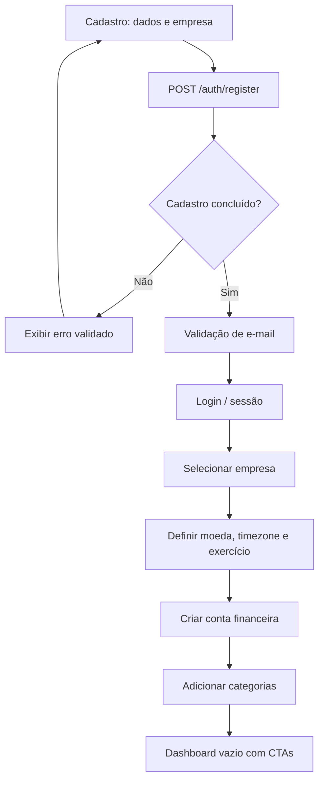

# PLANO_FRONTEND — Plataforma SaaS de Gestão Financeira, Orçamentos e Vendas

> **Status:** plano de implementação | **Idioma:** pt-BR | **Versão do documento:** 1.0 | **Data:** 11/11/2026  
> **Stack principal:** Next.js + TypeScript + Tailwind CSS + shadcn/ui + tailwind-merge + TanStack Charts (`@tanstack/charts/react`) + React Flow (`@xyflow/react`) + Axios + Docker.  
> **Documento complementar:** `plano_backend.md`. As decisões de tenant, entidades, valores monetários, permissões e API deste plano são contratos compartilhados com o backend.

---

## 1. Visão do produto e objetivos

Criar uma plataforma **B2B SaaS multi-tenant e white-label** para pequenas e médias empresas centralizarem finanças, orçamento planejado versus realizado e ciclo de vendas. O produto não é apenas um dashboard: deve permitir operar os dados, reconciliar lançamentos, registrar vendas, receber pagamentos, definir limites e visualizar tendências.

### 1.1 Personas e responsabilidades

| Persona | Tarefas principais | Escopo de acesso |
|---|---|---|
| Proprietário da conta | cadastro, cobrança, administração de empresas, usuários, parâmetros | account/tenant inteiro |
| Administrador da empresa | gerenciar usuários autorizados da empresa, categorias, orçamento e vendas | empresas atribuídas |
| Financeiro | gerir contas, receitas, despesas, transferências, recebíveis e relatórios | empresas atribuídas |
| Comercial | cadastrar clientes, produtos/serviços, propostas e vendas | empresas atribuídas |
| Colaborador/leitor | consultar dashboards e dados autorizados | permissões definidas |
| Administrador da plataforma/white-label | gerir marcas, módulos e contas do seu escopo | painel segregado de plataforma |

### 1.2 Objetivos mensuráveis

- Primeiro cadastro completo em até 5 minutos, incluindo conta, usuário, empresa e configuração inicial.
- Fluxos operacionais sem navegação excessiva: nova venda, nova despesa, recebimento e criação de orçamento com ações visíveis.
- Dashboard apresenta apenas dados verdadeiros retornados pela API; **não preencher cards com números fictícios em produção**.
- Todas as consultas e mutações condicionadas ao tenant e à empresa selecionada, com autorização final no backend.
- Layout responsivo e acessível em desktops, tablets e celulares.
- Componentes, navegação e tema configuráveis por white-label sem duplicar o frontend.

### 1.3 Fora do MVP

Emissão fiscal NF-e/NFS-e, Open Finance, conciliação bancária automática, folha de pagamento, contabilidade fiscal completa, estoque avançado, gateway de pagamentos e aplicativo nativo. Preparar interfaces e pontos de extensão, mas não apresentar funções sem backend funcional.

---

## 2. Leitura das referências visuais

O design combina as três imagens enviadas com os exemplos oficiais do shadcn/ui:

- **Referência A — Finexy:** cards de KPI, carteiras, atividades recentes, mini gráficos de receita/despesa, hierarquia visual financeira e cartões com destaque coral.
- **Referência B — Skillset:** sidebar com nomes, filtros de período, gráficos de barras, tabela, blocos densos porém claros e paleta neutra.
- **Referência C — NIKITIN:** sidebar escura compacta, ação primária colorida, resumo de cartões, lista de transações e painel lateral de estatísticas.
- **Login:** https://ui.shadcn.com/view/new-york-v4/login-02
- **Sidebar:** https://ui.shadcn.com/view/new-york-v4/sidebar-07

**Direção escolhida:** interface profissional *light-first*, superfícies brancas/cinza muito claro, tipografia preta/carvão, bordas finas, cantos arredondados e acento coral/laranja de referência; dashboard com bom uso de espaços em branco. Disponibilizar modo escuro sem usar preto absoluto como padrão. A cor de destaque deve ser token configurável do white-label — não hardcode em cada componente.

### 2.1 Design tokens

| Token semântico | Proposta default | Utilização |
|---|---|---|
| `--background` | cinza neutro muito claro | plano de fundo global |
| `--card` | branco | cards e painéis |
| `--foreground` | grafite quase preto | títulos e conteúdo |
| `--muted` / `--muted-foreground` | cinza claro / médio | secundário e superfícies |
| `--primary` | coral/laranja profundo | CTAs e destaques |
| `--success` | verde | recebidos, aumentos, concluídos |
| `--destructive` | vermelho | atrasos, erros, exclusões |
| `--warning` | âmbar | vencimentos e limites |
| `--radius` | 0.75rem–1rem | família de componentes |

Implementar tokens conforme contrato de CSS variables do shadcn; testar contraste WCAG AA. Gráficos devem usar tokens e padrões visuais distintos para não depender apenas de cor.

### 2.2 Layout desktop

```text
┌──────────────────┬────────────────────────────────────────────────────────┐
│ Logo + Empresa   │ Header: breadcrumb | busca | período | alertas | user │
│                  ├────────────────────────────────────────────────────────┤
│ Dashboard        │ KPIs: saldo | receitas | despesas | resultado         │
│ Financeiro       ├──────────────────────────────────┬─────────────────────┤
│  Contas          │ Receitas × despesas (gráfico)    │ Distribuição gastos │
│  Transações      ├──────────────────────────────────┴─────────────────────┤
│  Pagar/Receber   │ Orçamentos / fluxo de caixa / visão por empresa       │
│ Orçamentos       ├────────────────────────────────────────────────────────┤
│ Vendas           │ Últimas transações / vendas / vencimentos             │
│ Clientes         └────────────────────────────────────────────────────────┘
│ Relatórios       
│ Automações       
│ Administração    
└──────────────────┘
```

- Desktop: sidebar expandida de 240–272px, opção colapsada em ícones; header sticky; conteúdo com largura fluida.
- Tablet: sidebar colapsável; tabela pode alternar para densidade compacta.
- Mobile: menu via `Sheet`, cards em coluna, filtros em `Drawer`, tabelas em cards; ações críticas continuam disponíveis.
- Layout consistente entre empresas, com alternador no header e persistência da escolha apenas para conveniência visual.

---

## 3. Stack e decisões técnicas

| Camada | Tecnologia | Motivo/decisão |
|---|---|---|
| Framework | Next.js App Router + React + TypeScript strict | layouts, SSR para carregamento inicial, rotas organizadas |
| UI | shadcn/ui + Radix primitives + Lucide | componentes acessíveis e customizáveis |
| Styling | Tailwind CSS + `tailwind-merge` + `clsx` | tokens, composição e resolução de conflitos |
| Gráficos | **`@tanstack/charts` com adapter `@tanstack/charts/react`** | gráficos tipados e compatíveis com o ecossistema TanStack; o antigo nome `@tanstack/react-charts` é compatibilidade |
| Diagramas | **`@xyflow/react`** | fluxos visuais de aprovação, cobrança e orçamento |
| HTTP | Axios | interceptors, timeout, serialização, erros |
| Dados de servidor | TanStack Query | cache, deduplicação e revalidação de queries |
| Formulários | React Hook Form + Zod | schemas compartilhados e mensagens consistentes |
| Tabelas | TanStack Table + shadcn DataTable | paginação/sort/filtros remotos |
| Datas | date-fns ou Temporal polyfill (validar) | datas locais e ISO; exibir timezone da empresa |
| Estado de interface | Zustand **somente** para estado local persistível | sidebar, filtros temporários e preferências; não armazenar tokens |
| Testes | Vitest, Testing Library, Playwright, MSW | unit, UI, E2E, mocks |
| Qualidade | ESLint, Prettier, TypeScript strict | consistência |
| Empacotamento | Docker multi-stage, Next standalone | imagem reproduzível |

**Regra de compatibilidade:** fixar versões exatas no lockfile e validar a combinação Next/React/shadcn/Charts no bootstrap. Não adotar APIs de documentação `main` não publicadas sem conferência da release instalada.

### 3.1 Instalação inicial sugerida

```bash
pnpm create next-app@latest finance-web --typescript --tailwind --eslint --app --src-dir --import-alias '@/*'
cd finance-web
pnpm dlx shadcn@latest init
pnpm dlx shadcn@latest add button card sidebar sheet dropdown-menu dialog alert-dialog \
  input textarea label form select badge avatar tabs table skeleton progress \
  calendar popover command separator scroll-area tooltip breadcrumb sonner
pnpm add axios @tanstack/react-query @tanstack/react-table @tanstack/charts \
  @xyflow/react react-hook-form @hookform/resolvers zod \
  clsx tailwind-merge lucide-react date-fns zustand
pnpm add -D vitest @testing-library/react @testing-library/jest-dom \
  @playwright/test msw
```

> Comandos ilustram dependências pretendidas. Revisar opções/CLI conforme versão instalada e não duplicar pacotes já incluídos pelo scaffold.

---

## 4. Organização do repositório (feature-based)

```text
finance-web/
├── public/
├── src/
│   ├── app/
│   │   ├── (public)/
│   │   │   ├── login/page.tsx
│   │   │   ├── cadastro/page.tsx
│   │   │   ├── recuperar-senha/page.tsx
│   │   │   ├── redefinir-senha/page.tsx
│   │   │   └── aceitar-convite/[token]/page.tsx
│   │   ├── (onboarding)/configuracao-inicial/page.tsx
│   │   ├── (app)/
│   │   │   ├── layout.tsx
│   │   │   ├── dashboard/page.tsx
│   │   │   ├── financeiro/contas/page.tsx
│   │   │   ├── financeiro/transacoes/page.tsx
│   │   │   ├── financeiro/a-pagar/page.tsx
│   │   │   ├── financeiro/a-receber/page.tsx
│   │   │   ├── financeiro/fluxo-de-caixa/page.tsx
│   │   │   ├── orcamentos/page.tsx
│   │   │   ├── orcamentos/[id]/page.tsx
│   │   │   ├── vendas/page.tsx
│   │   │   ├── vendas/[id]/page.tsx
│   │   │   ├── clientes/page.tsx
│   │   │   ├── catalogo/page.tsx
│   │   │   ├── relatorios/page.tsx
│   │   │   ├── automacoes/page.tsx
│   │   │   └── configuracoes/
│   │   │       ├── empresa/page.tsx
│   │   │       ├── equipe/page.tsx
│   │   │       ├── categorias/page.tsx
│   │   │       └── aparencia/page.tsx
│   │   ├── (platform)/plataforma/...  # acesso segregado
│   │   ├── api/bff/...                 # handlers server-side necessários
│   │   ├── globals.css
│   │   ├── layout.tsx
│   │   ├── not-found.tsx
│   │   └── error.tsx
│   ├── components/
│   │   ├── ui/                        # componentes shadcn
│   │   ├── layout/                     # app-sidebar, app-header
│   │   ├── charts/                     # chart-card, chart-legend
│   │   ├── data-table/                 # table, columns, toolbar
│   │   ├── money/                      # money-value, money-input
│   │   └── feedback/                   # empty-state, error-state
│   ├── features/
│   │   ├── auth/
│   │   ├── dashboard/
│   │   ├── companies/
│   │   ├── accounts/
│   │   ├── transactions/
│   │   ├── receivables/
│   │   ├── payables/
│   │   ├── budgets/
│   │   ├── sales/
│   │   ├── customers/
│   │   ├── products/
│   │   ├── reports/
│   │   ├── automations/
│   │   ├── teams/
│   │   └── whitelabel/
│   ├── lib/
│   │   ├── api/client.ts
│   │   ├── api/server-client.ts
│   │   ├── api/errors.ts
│   │   ├── auth/session.ts
│   │   ├── auth/permissions.ts
│   │   ├── validation/
│   │   ├── format/money.ts
│   │   ├── format/dates.ts
│   │   └── utils.ts
│   ├── providers/
│   ├── hooks/
│   ├── types/
│   └── tests/
├── e2e/
├── Dockerfile
├── .env.example
├── next.config.ts
└── package.json
```

**Padrão para cada feature:** `components/`, `hooks/`, `services/`, `queries/`, `schemas/`, `types/`, `constants/`, `tests/`. Não duplicar contratos de resposta manualmente: preferir cliente tipado gerado do OpenAPI versionado do backend.

---

## 5. Contrato de identidade, multi-tenancy e white-label

### 5.1 Identificadores e escopos

- Todos os IDs de entidade e relacionamentos são **UUID v7** gerados e validados pelo backend; o cliente trata IDs como strings opacas. Não usar `crypto.randomUUID()` para criar IDs persistentes (gera UUIDv4).
- `accounts.id` é a raiz da conta/tenant. Em todos os registros de negócio, `tenant = accounts.id`.
- `tenant_owner = whitelabels.id` identifica a marca/operador proprietário da conta, **não** o usuário que fez login.
- `users` é um perfil **restrito a um tenant** no MVP. O mesmo e-mail poderá ter registros de usuário distintos em tenants diferentes; login precisa de contexto de workspace (slug/domínio) ou seleção segura.
- `accounts_users` representa a adesão/permissão do usuário na conta; `users_companies` define as empresas às quais tem acesso. Se houver compartilhamento de identidade entre tenants futuramente, criar camada `auth_identities`, preservando `users` por tenant.
- `accounts.role = ADMIN | USER` é campo obrigatório legado/do negócio; **não é prova suficiente de autorização do usuário**. Para autorização, o frontend recebe as permissões efetivas do vínculo `accounts_users`, papéis por empresa e features habilitadas.

### 5.2 Estratégia de white-label

Fluxo da requisição:

1. Host recebido (`app.produto.com` ou `marca.cliente.com`).
2. Backend resolve o white-label por domínio **validado**, não por string enviada pelo navegador.
3. `GET /api/v1/public/branding` retorna identidade visual pública, domínio canônico e recursos autorizados para login.
4. Após autenticação, `GET /api/v1/auth/me` retorna tenant, empresa ativa sugerida, membership roles, permissões e features efetivas.
5. Componentes passam a usar `branding.logoUrl`, `branding.primaryColor`, `branding.productName` e textos controlados.
6. Troca de empresa refaz todas as queries e reinicializa filtros associados; a escolha visual não autoriza nenhuma consulta.

Nunca permitir que `tenant` ou `tenant_owner` provenientes de formulários controlem a query ou persistência. É permitido enviar `X-Company-Id` ou campo equivalente **apenas como intenção**, sujeito a validação server-side. `X-Tenant-Id` de navegador não é fonte de confiança.

### 5.3 Permissões e matriz inicial

| Recurso/ação | Owner | Admin | Financeiro | Comercial | Leitor |
|---|---:|---:|---:|---:|---:|
| Dashboard e relatórios do escopo | ✓ | ✓ | ✓ | limitados | ✓ |
| Contas/transações | ✓ | ✓ | ✓ | — | somente leitura |
| Orçamentos financeiros | ✓ | ✓ | ✓ | — | somente leitura |
| Clientes/catálogo | ✓ | ✓ | ✓ | ✓ | leitura |
| Vendas/propostas | ✓ | ✓ | leitura | ✓ | leitura |
| Usuários/permissões | ✓ | ✓ limitado | — | — | — |
| Marca/assinatura | ✓ | — | — | — | — |

A matriz é sugestão inicial. Backend define `permissions: string[]`, como `sales.write`, `budget.approve`, `financial.read`, `users.invite`. O frontend apenas orienta a UX; **não substitui a autorização na API**.

---

## 6. Experiência de autenticação e onboarding

### 6.1 Telas públicas

| Tela | Campos/ações | Resultado esperado |
|---|---|---|
| Login `/login` | e-mail, senha, mostrar senha, esqueci senha, entrar | sessão autenticada/erro claro |
| Cadastro `/cadastro` | nome, e-mail, senha, nome empresa, aceite obrigatório | provisionar account+user+company atomicamente |
| Confirmar e-mail | token e opção reenviar | e-mail verificado |
| Recuperar senha | e-mail/contexto do workspace | link temporário sem enumeração |
| Redefinir senha | token, nova senha, confirmação | invalidar sessões antigas |
| Aceitar convite | dados convite, autenticação/cadastro associado | associa usuário/empresa sem duplicação |

### 6.2 Proposta visual do login

Utilizar estrutura do `login-02` como inspiração para uma tela de duas colunas: à esquerda formulário, à direita painel de produto com render de dashboard/benefícios sem dados reais. Em mobile, apenas o formulário. Respeitar tema do white-label, manter alternativa de autenticação social apenas quando implementada de ponta a ponta.

### 6.3 Onboarding (estado inicial)



- Cadastro de `accounts`, `users`, `companies`, `accounts_users` e `users_companies` é responsabilidade do **backend**, dentro da mesma transação; frontend faz uma única chamada.
- Nunca mostrar passos realizados parcialmente quando o backend responde erro.
- Caso sessão expirada, preservar formulário não sensível e redirecionar ao login.
- Concluir onboarding mesmo sem transações, sem criar transações demonstrativas no tenant de produção.

### 6.4 Sessão recomendada

Adotar **BFF (Backend for Frontend)** no Next.js para isolar tokens de acesso/refresh. Sessão em cookie `HttpOnly`, `Secure`, `SameSite` apropriado, com proteção CSRF em métodos mutáveis. Rotas server-side trocam cookie/sessão por credencial apropriada na chamada à API; não armazenar JWT em `localStorage`, Zustand ou `NEXT_PUBLIC_*`. Validar autorização no backend em todas as operações. Definir rotação de refresh token e tratamento de expiração.

---

## 7. Navegação e módulos funcionais

### 7.1 Mapa de navegação

| Grupo | Menu | Rota principal | MVP |
|---|---|---|---|
| Visão geral | Dashboard | `/dashboard` | ✓ |
| Financeiro | Contas financeiras | `/financeiro/contas` | ✓ |
| Financeiro | Transações | `/financeiro/transacoes` | ✓ |
| Financeiro | Contas a pagar | `/financeiro/a-pagar` | ✓ |
| Financeiro | Contas a receber | `/financeiro/a-receber` | ✓ |
| Financeiro | Fluxo de caixa | `/financeiro/fluxo-de-caixa` | ✓ |
| Planejamento | Orçamentos | `/orcamentos` | ✓ |
| Comercial | Vendas | `/vendas` | ✓ |
| Comercial | Clientes | `/clientes` | ✓ |
| Comercial | Catálogo | `/catalogo` | ✓ |
| Inteligência | Relatórios | `/relatorios` | ✓ |
| Automação | Fluxos de aprovação/cobrança | `/automacoes` | fase 2 |
| Administração | Empresas, usuários, categorias | `/configuracoes/*` | ✓ |
| Plataforma | White-label e features | `/plataforma/*` | fase 2 |

### 7.2 Dashboard executivo

**Filtros globais:** período (mês/ano/intervalo), empresa (uma ou todas autorizadas), conta financeira opcional e modo caixa ou competência (quando ambos disponíveis). Persistir critérios na query string com valores validados.

**Linha 1:** saldo disponível; receitas recebidas; despesas pagas; resultado líquido. Cada card apresenta período, comparação com período anterior apenas se calculável e tooltip com fórmula.

**Linha 2:** gráfico temporal receitas versus despesas; distribuição de despesas por categoria; saldos por conta.

**Linha 3:** valores a receber e a pagar por vencimento, orçamento executado (planejado/realizado), últimos lançamentos e últimas vendas.

**Definições para não misturar conceitos:**

- `saldo atual` = soma dos movimentos financeiros confirmados das contas selecionadas, incluindo saldo inicial.
- `receita recebida` = movimentos positivos classificados como recebimento de terceiros (não transferências internas).
- `despesa paga` = saídas pagas a terceiros (não transferências internas).
- `resultado de caixa` = receitas recebidas − despesas pagas no período.
- `vendas realizadas` = pedidos confirmados no período (não implica recebimento).
- `a receber` = saldo em aberto de parcelas do cliente, independentemente do mês da venda.

Usar endpoints agregados (`GET /dashboard/summary`, `/dashboard/cashflow`, `/dashboard/categories`, `/dashboard/alerts`), não transferir todos os lançamentos ao navegador para somar.

### 7.3 Contas financeiras

- Tipos: conta corrente, caixa, carteira, poupança/outros (somente classificação).
- CRUD com apelido, banco/instituição, moeda, saldo inicial, data de abertura e status.
- Cartões para saldo e conta principal; lista com filtro por empresa.
- Transferência entre contas exige origem, destino, valor positivo, data e confirmação; mostrar efeito em ambas as contas, sem contabilizar como receita ou despesa.
- Não permitir edição direta do saldo: correção via lançamento de ajuste auditável.

### 7.4 Transações

- Tabela: data, descrição, conta, categoria, cliente/fornecedor opcional, tipo, status, valor, ações.
- Filtros remotos: intervalo, tipo, conta, categoria, status, busca e paginação.
- Ações: criar receita, criar despesa, criar transferência, confirmar/agendar/cancelar conforme estado, anexos em fase 2.
- Formulário com validação de valor, data, conta e categoria; *MoneyInput* sem ponto flutuante para envio de valor.
- Detalhe com trilha de auditoria, movimentações resultantes e ações disponíveis.
- Confirmados são imutáveis contabilmente; correção via estorno e relançamento, não sobrescrever movimentos históricos.

### 7.5 Contas a pagar e a receber

- Listagem por vencimento com abas `Em aberto`, `Vencidos`, `Parcial`, `Liquidados`, `Cancelados`.
- Criar obrigação manual e gerar por venda aprovada; oferecer parcelamento com soma consistente.
- Registradores de baixa parcial/total, exibindo saldo restante.
- Alertas de vencimento e filtros por contraparte; histórico de pagamentos.
- Distinguir **previsão** de caixa (a vencer) de **realizado** (baixas efetivas).

### 7.6 Orçamentos financeiros

- Criar orçamento por empresa, período e categorias/centros de custo.
- Formulário em grade: categoria, limite, responsável, alerta em %, descrição.
- Dashboard de planejado, realizado, comprometido (opcional) e disponível.
- Gráfico horizontal por categoria, barras de progresso, estados `normal`, `alerta` e `acima do limite`.
- Workflow de estado: `DRAFT → SUBMITTED → APPROVED → ACTIVE → CLOSED`; mudanças requerem permissões do backend.
- Abrir detalhamento dos movimentos contabilizados no realizado; comparar períodos.
- Ao configurar limite, definir se é apenas informativo (padrão MVP) ou bloqueante (futuro).

### 7.7 Gestão de vendas

**Clientes:** CPF/CNPJ quando aplicável, nome, e-mail/telefone, endereço, status, histórico de vendas e recebíveis. Máscaras são conforto, validação obrigatória no servidor; proteger PII.

**Catálogo:** produtos e serviços, SKU opcional, unidade, preço base, status; não implementar estoque automaticamente.

**Vendas:** listagem, criação, edição em rascunho, confirmação, cancelamento conforme regras, detalhe, itens (quantidade, preço unitário, desconto), subtotal, impostos informativos quando configurados, total e condições de pagamento. Registrar snapshot de descrição/preço do item.

**Integração financeira:** ao confirmar venda, criar recebíveis conforme condições; o caixa **só** muda quando um recebimento for liquidado. Na tela de venda mostrar `total`, `recebido`, `em aberto`, e histórico de recebimentos. Cancelamento após baixa exige fluxo de devolução/estorno, nunca exclusão silenciosa.

### 7.8 Relatórios

- DRE **gerencial simplificada** somente se receitas/despesas classificadas adequadamente; rotular explicitamente como gerencial, não fiscal.
- Receitas/despesas por categoria e empresa.
- Fluxo de caixa realizado e projetado.
- Contas a receber e a pagar por faixa de atraso.
- Vendas por período, cliente e produto/serviço.
- Exportação CSV no MVP; PDF/Excel em fase 2 se endpoints disponíveis, com permissão específica e auditoria.
- Exibir data/hora de geração e filtros aplicados; nenhuma métrica misturando moedas distintas.

### 7.9 Editor de automações com React Flow (fase 2)

Casos iniciais: aprovação de orçamento acima de um limite, alerta de vencimento, pedido de aprovação de despesas. O editor **não executa regras no browser**; desenha e valida uma definição que o servidor versiona e interpreta.

```text
[Gatilho: conta vence em 3 dias]
              │
              ▼
[Condição: ainda está em aberto?] ── NÃO ──> [Encerrar]
              │ SIM
              ▼
[Ação: notificar financeiro] ───────────────> [Encerrar]
```

**Nós:** `trigger`, `condition`, `action`, `end`; arestas direcionadas; schema de dados discriminado por tipo. Validar ciclos indevidos, nós órfãos, limites por plano e permissões antes de publicar. Versões `draft` e `published`, visualização do histórico de execuções e falhas. Nunca executar JavaScript arbitrário enviado do navegador.

---

## 8. Contratos frontend ↔ API

API REST em `/api/v1`, JSON `camelCase`, timestamps ISO-8601 com offset/UTC, moeda em código ISO 4217 e **decimais monetários enviados como string** (exemplo: `"1250.50"`), para evitar precisão binária. IDs: UUID v7 string. Endpoints paginados respondem com metadados de paginação.

### 8.1 Envelope recomendado

```ts
export type ApiPage<T> = {
  items: T[];
  page: number;
  size: number;
  totalItems: number;
  totalPages: number;
};

export type ApiError = {
  type: string;
  title: string;
  status: number;
  detail?: string;
  instance?: string;
  code?: string;
  fieldErrors?: Record<string, string[]>;
  traceId?: string;
};

export type Money = {
  amount: string;   // decimal exato, ex.: "1049.90"
  currency: 'BRL' | string;
};
```

Erros seguem `application/problem+json` (RFC 9457) com extensões pactuadas. Não presumir envelope `{ data: ... }` para sucessos se contrato OpenAPI não especificar.

### 8.2 Principais endpoints consumidos

| Recurso | Leitura | Escrita/ação |
|---|---|---|
| Auth | `GET /auth/me` | `POST /auth/register`, `/auth/login`, `/auth/refresh`, `/auth/logout` |
| Branding | `GET /public/branding` | configurações via `/platform/whitelabels` |
| Empresas | `GET /companies` | `POST /companies`, `PATCH /companies/{id}` |
| Equipe | `GET /users`, `/memberships` | `POST /invitations`, `PATCH /memberships/{id}` |
| Contas | `GET /financial-accounts` | `POST /financial-accounts`, `PATCH /financial-accounts/{id}` |
| Transações | `GET /transactions` | `POST /transactions`, `/transactions/{id}/confirm`, `/transactions/{id}/reverse` |
| Transferências | `GET /transfers` | `POST /transfers` |
| Pagáveis | `GET /payables` | `POST /payables`, `POST /payables/{id}/payments` |
| Recebíveis | `GET /receivables` | `POST /receivables`, `POST /receivables/{id}/payments` |
| Orçamentos | `GET /budgets` | `POST /budgets`, `POST /budgets/{id}/submit`, `/approve` |
| Vendas | `GET /sales` | `POST /sales`, `POST /sales/{id}/confirm`, `/cancel` |
| Clientes | `GET /customers` | `POST /customers`, `PATCH /customers/{id}` |
| Catálogo | `GET /catalog-items` | `POST /catalog-items`, `PATCH /catalog-items/{id}` |
| Dashboard | `/dashboard/summary`, `/dashboard/cashflow`, `/dashboard/categories` | somente leitura |
| Relatórios | `GET /reports/*` | `POST /exports` se export assíncrono |
| Fluxos | `GET /workflows` | `POST /workflows`, `/workflows/{id}/publish` |

**Especificar e versionar OpenAPI antes da implementação dos módulos.** Gerar tipos e cliente em CI para evitar divergência. Para listagens, padronizar `page`, `size`, `sort`, `q`, `startDate`, `endDate`, `companyId` e filtros de status.

### 8.3 Exemplo de transação (request)

```json
{
  "companyId": "019a9d3e-c9bd-7c01-8a6d-8e47f7b9a001",
  "financialAccountId": "019a9d3e-c9bd-7c01-8a6d-8e47f7b9a002",
  "categoryId": "019a9d3e-c9bd-7c01-8a6d-8e47f7b9a003",
  "type": "EXPENSE",
  "description": "Internet escritório",
  "amount": "249.90",
  "currency": "BRL",
  "effectiveDate": "2026-11-11",
  "status": "SCHEDULED"
}
```

Os UUIDs acima ilustram apenas o formato. `tenant`, `tenantOwner`, `createdAt` e `updatedAt` **não são aceitos no POST**: derivam da sessão e do backend.

---

## 9. Estratégia de dados, cache e HTTP

### 9.1 Axios e BFF

- `browser → Next.js BFF → Spring Boot API` para ações autenticadas; cookies ficam sob domínio do frontend e apenas BFF conhece tokens da API.
- BFF anexa contexto autenticado e encaminha o `companyId` solicitado; Spring valida autorização, permissões e tenant.
- Timeout com erros padronizados; refresh token feito no servidor com sincronização contra chamadas paralelas; erro 401 redireciona para login apenas após tentativa permitida de renovação.
- `Idempotency-Key` nas mutações que criam lançamentos, pagamentos, vendas e transferências, gerada pelo cliente por tentativa lógica e reutilizada em retry.
- `X-Correlation-Id` gerado pelo gateway/BFF ou preservado se confiável; nunca expor trace com PII.

### 9.2 Query keys e invalidação

```ts
export const queryKeys = {
  dashboard: (tenant: string, company: string, period: string) =>
    ['dashboard', tenant, company, period] as const,
  transactions: (tenant: string, company: string, filters: object) =>
    ['transactions', tenant, company, filters] as const,
  budgets: (tenant: string, company: string, period: string) =>
    ['budgets', tenant, company, period] as const,
};
```

- Incluir identificadores de tenant, empresa, período e filtros em toda `queryKey` autenticada.
- Ao trocar conta/empresa ou sair: cancelar requests, limpar caches sensíveis, resetar estados e só então carregar o novo contexto.
- Queries de saldo/caixa invalidam após transação, transferência e baixa; budgets após lançamentos ou alteração de limites; relatórios usam invalidação por domínio.
- SSR: não cachear respostas sensíveis entre usuários/tenants. Configurar `no-store` ou cache por requisição autenticada quando necessário.

### 9.3 Estados de interface obrigatórios

Toda listagem/tela: `loading`, `empty`, `error`, `success`, `forbidden` e `no-results`. Diferenciar `sem dados` de `filtros não retornaram resultados`. Usar `Skeleton` nas geometrias reais, `Sonner` para confirmações, retry explícito e feedback em operações longas.

---

## 10. Componentes e padrões de implementação

### 10.1 Biblioteca de componentes de negócio

| Componente | Responsabilidade |
|---|---|
| `DashboardKpiCard` | valor, tendência, comparação e tooltip metodológico |
| `FinanceChart` | séries com unidade/legenda e estados de carregamento |
| `MoneyInput` | entrada decimal localizada e normalização para string |
| `MoneyValue` | `Intl.NumberFormat` por currency/locale |
| `DateRangePicker` | intervalo sem confundir fuso e dia civil |
| `CompanySwitcher` | lista de empresas autorizadas, reset de cache |
| `AccountSwitcher` | seleção de workspace quando houver múltiplos |
| `EntityDataTable` | filtro remoto, paginação, seleção e ações |
| `TransactionForm` | campos de entrada e regras por tipo |
| `BudgetProgressCard` | realizado/limite/variação e estado acessível |
| `SaleItemsEditor` | itens, quantidade decimal e totais calculados/confirmados |
| `StatusBadge` | status sempre com texto, não apenas cor |
| `FeatureGate` | esconder ações indisponíveis por feature; backend também valida |
| `PermissionGate` | exibição condicional; backend também valida |
| `WorkflowEditor` | nós, arestas e edição de fluxos |

### 10.2 Precisão de valores

- Exibir `R$ 1.234,56`, mas enviar `"1234.56"`; não converter valores para `Number` para somas financeiras autoritativas.
- Biblioteca decimal como `decimal.js` pode ser adicionada para cálculos **de preview** em itens, sempre com resultado do servidor como fonte final.
- Arredondamento definido por contrato (por item, por linha, ao final) e testado; valores negativos só onde permitidos.
- Moeda inicialmente BRL por empresa; exibir aviso/impedir consolidação de moedas diferentes sem conversão e taxa registrada.

### 10.3 Acessibilidade

- Navegação por teclado e foco visível; `aria-label` em botões somente ícone.
- Formularios com erros vinculados aos inputs, labels e mensagens claras.
- Modais de confirmação para cancelamento/estorno; suporte a Escape com prevenção de perda de alterações.
- Tabelas com `scope` e ordenação semântica; gráficos com descrição e alternativa tabular para leitores de tela.
- Testar responsividade e zoom de 200%.

---

## 11. Regras detalhadas de frontend para cada fluxo

### 11.1 Nova despesa

1. Usuário seleciona empresa autorizada.
2. Clica `Nova despesa`; formulário abre com conta/categoria/data/descrição/valor.
3. Validação no client (formato) e no backend (regra de negócio).
4. `POST /transactions` com chave de idempotência; backend devolve recurso `SCHEDULED`.
5. UI mostra situação agendada; `Confirmar pagamento` gera movimento financeiro efetivo.
6. Invalida saldos, dashboards, listas e orçamento; exibe comprovante/resumo.

### 11.2 Nova venda e recebimento

1. Selecionar empresa, cliente, produtos/serviços, quantidade e desconto.
2. Mostrar resumo do pedido; salvar `DRAFT`.
3. Confirmar `DRAFT → CONFIRMED`; backend congela valores e cria parcelas/recebíveis.
4. UI exibe `em aberto`, datas de vencimento e links de baixa.
5. Registrar recebimento parcial/total na parcela; mostrar estado `PARTIAL` ou `PAID`.
6. Dashboard financeiro atualiza **somente após baixa**, enquanto relatório comercial pode atualizar na confirmação da venda.

### 11.3 Aprovação de orçamento

1. Criar rascunho por competência/período e categorias.
2. Solicitar aprovação; travar campos incompatíveis com estado `SUBMITTED`.
3. Aprovador visualiza diferenças, limites e contexto; aprova/rejeita com justificativa.
4. Após aprovação, UI habilita monitoramento; valor realizado vem de despesas confirmadas classificadas.
5. Ao ultrapassar threshold, exibir alerta. Bloqueio de transação só quando política explícita estiver habilitada no backend.

### 11.4 Convites e usuários

1. Owner/Admin envia convite com e-mail, empresa(s) e papel.
2. Link de uso único e expiração controlados pelo backend.
3. Convidado valida identidade, aceita e cria/associa registro tenant-scoped.
4. UI refaz `/auth/me` e mostra permissões.
5. Revogação reflete imediatamente na API; UI limpa cache ao detectar `403`.

---

## 12. Qualidade, performance, observabilidade e segurança

### 12.1 Metas iniciais

- Core Web Vitals: LCP < 2,5s, INP < 200ms, CLS < 0,1 em dispositivos alvo/condições controladas.
- Rotas com bundle enxuto; carregar Charts e React Flow dinamicamente (`next/dynamic`) nos módulos que precisam.
- Não requisitar todos os registros para paginar no browser; tabelas com paginação no servidor.
- Exportações longas assíncronas ou streaming, com progress/estado.
- Fontes locais ou otimizadas via `next/font`; reduzir dependências e imagens hero pesadas.

### 12.2 Segurança do cliente/BFF

- Cookies `HttpOnly`, `Secure`, `SameSite`; proteção CSRF quando necessário.
- Nunca confiar em filtros tenant, flags de feature, hidden fields, role do client ou ID de empresa sem validação server-side.
- CSP, HSTS, validação de URLs de imagens/logos e política de upload.
- Prevenir XSS em descrições e nomes; React escaping por padrão; sanitizar HTML rico se introduzido.
- Não colocar tokens, senhas, CPF/CNPJ ou dados financeiros sensíveis nos logs analíticos.
- `403` deve produzir página de acesso negado; `404` para recurso inexistente ou de outro tenant sem revelar existência.

### 12.3 Instrumentação

- Web Vitals e erros JS com trace/correlation id e user/tenant pseudonimizados.
- Métricas de produto: conclusão do cadastro, tempo da primeira transação, conversão em venda, adoção de orçamentos.
- Logs estruturados de falhas de rede e fluxos sem segredos.
- Não confundir métricas de UX com logs de auditoria financeira (estes ficam no backend).

### 12.4 Estratégia de testes

| Nível | Ferramenta | Cobertura obrigatória |
|---|---|---|
| Unit | Vitest | formatos monetários, datas, validações, permissões visuais |
| Component | Testing Library | forms, tabelas, dashboard, menus, erro/empty/loading |
| Contract | OpenAPI + MSW | status, payload, paginação, problem details |
| E2E | Playwright | onboarding, login, CRUD, venda → recebível → baixa |
| E2E multi-tenant | Playwright | trocar empresa, 403/404, limpar cache e marca |
| Visual | screenshots estáveis | layouts 375/768/1280/1440, tema claro/escuro |
| A11y | axe/Playwright | formulário, navegação, gráfico e modal |

---

## 13. Docker, variáveis e ambientes

### 13.1 Variáveis sugeridas

```dotenv
# browser-accessible: somente valores públicos
NEXT_PUBLIC_APP_URL=http://localhost:3000

# server only; NUNCA usar prefixo NEXT_PUBLIC_
BACKEND_INTERNAL_URL=http://backend:8080/api/v1
SESSION_COOKIE_NAME=finance_session
SESSION_SECRET=definir_segredo_forte_em_runtime
NODE_ENV=production
```

Conceber imagens Docker com build multi-stage e output `standalone`, usuário não-root, endpoint de saúde e `healthcheck`. Nunca incluir `.env` real, tokens ou chaves na imagem. Usar `docker compose` local com frontend/backend/PostgreSQL e um reverse proxy somente onde necessário; HTTPS em produção.

### 13.2 Estratégia de ambientes

| Ambiente | Objetivo | Dados |
|---|---|---|
| local | desenvolvimento com mocks e PostgreSQL local | seed de testes |
| CI | lint, build, testes | dados efêmeros |
| staging | homologar fluxos ponta a ponta | dados sintéticos/anônimos |
| production | operação real | banco persistente, backups, HTTPS |

Deploy por imagem versionada; rodar frontend sem migrações SQL. Migração e seed são do backend.

---

## 14. Roadmap de implementação detalhado

> Estimativas são **faixas para priorização**, não cronograma garantido. Assumem 1 dev frontend experiente e API/contrato disponíveis progressivamente.

### Fase F0 — Fundação (3–5 dias úteis)

- [ ] Inicializar Next.js + TypeScript strict + shadcn/ui + Tailwind.
- [ ] Definir tokens, tipografia, paleta light/dark e grid responsivo.
- [ ] Implementar `AppSidebar`, `AppHeader`, `Breadcrumbs`, `CompanySwitcher` e shell.
- [ ] Configurar lint/testes, formatter, aliases, Docker e CI.
- [ ] Adicionar Axios, TanStack Query e tratamento de erros.
- [ ] Integrar geração de tipos OpenAPI com ambiente mock.

**Aceite:** app sobe com Docker, shell navega, build/test/lint passam, sem dados sensíveis hardcoded.

### Fase F1 — Autenticação e identidade (4–7 dias)

- [ ] Reproduzir experiência funcional do login-02 com branding.
- [ ] Criar cadastro, recuperação, confirmação de e-mail, convites e onboarding.
- [ ] Implantar sessão BFF com cookies seguros e refresh.
- [ ] Consumir `/auth/me`, permissões, empresa ativa e branding.
- [ ] Impedir acesso não autenticado e tratar 401/403.
- [ ] Garantir logout com limpeza de cache e cookies.

**Aceite:** cadastro real cria conta/usuário/empresa; usuário não acessa recursos sem sessão; convites respeitam escopo.

### Fase F2 — Dashboard e financeiro (7–12 dias)

- [ ] KPIs e filtros; charts usando backend agregado.
- [ ] CRUD de contas financeiras; saldo e movimentos.
- [ ] Criar/listar/confirmar/reverter transações e transferências.
- [ ] Paginação, filtros URL e estados de tela.
- [ ] Contas a pagar e a receber com baixas parciais.
- [ ] Recalcular/invalidate dados relevantes ao retornar da API.

**Aceite:** saldo fecha com movimentos e transferências não inflacionam receita/despesa; nenhum vazamento entre empresas.

### Fase F3 — Orçamentos (4–7 dias)

- [ ] CRUD de orçamento e limites por categoria.
- [ ] Ações submit/approve/reject e trilha de estado.
- [ ] Gráficos planejado/realizado, alertas, comparativos.
- [ ] Drill-down e permissões.

**Aceite:** dashboard orçamentário reproduz valores calculados pelo backend; usuário sem direito não aprova.

### Fase F4 — Vendas e catálogo (6–10 dias)

- [ ] CRUD clientes e produtos/serviços.
- [ ] Editor de venda com itens, descontos e parcelas.
- [ ] Confirmação, cancelamento e status financeiro.
- [ ] Integração venda → recebível → baixa.
- [ ] Histórico de vendas e detalhes.

**Aceite:** venda confirmada gera recebível sem antecipar saldo; baixa altera caixa apenas uma vez.

### Fase F5 — Relatórios e gestão (5–8 dias)

- [ ] Relatórios com filtros e exportação CSV.
- [ ] Gerenciamento de empresas, membros e papéis.
- [ ] Settings de categorias, moeda/timezone e preferências.
- [ ] Empty/error states; revisão a11y e responsividade.
- [ ] Endurecimento de observabilidade e testes cross-tenant.

**Aceite:** proprietário delega acesso, relatórios batem com API e dados de outro tenant são inacessíveis.

### Fase F6 — White-label e automações (fase 2, 7–15 dias)

- [ ] Painel segregado de marca e recursos.
- [ ] Branding por domínio, logo e tokens sem recompilar.
- [ ] Feature gates por tenant/white-label.
- [ ] Editor React Flow, publish/versionamento, execução no backend.
- [ ] Tela de logs de execução e falhas.

**Aceite:** duas marcas com domínios/temas diferentes usam mesmo build e não compartilham dados ou permissões.

---

## 15. Definição de pronto (Definition of Done)

Para cada entrega:

1. Layout de alta fidelidade conforme referências, em desktop/mobile, com acessibilidade e tema.
2. API real integrada, tipos alinhados ao OpenAPI; sem dados mockados em produção.
3. Permissões/feature gates aplicados e revalidados pelo backend.
4. Estados de loading/empty/error/forbidden implementados.
5. Cobertura de casos felizes, validações, falhas, reenvio e concorrência conforme risco.
6. Cache isolado por tenant/empresa e invalidado após mutação.
7. Logs sem PII; erro rastreável por `traceId`.
8. Pull request revisada, CI aprovado, deploy staging, checklist de regressão executado.

### 15.1 Cenários de aceite fim a fim prioritários

- **A01:** Cadastrar usuário + empresa; conta aparece, onboarding inicia e tenant/white-label não são expostos para edição.
- **A02:** Criar duas contas/empresas independentes; transações de A nunca aparecem em B, inclusive no cache pós-troca.
- **A03:** Criar conta financeira, receita e despesa; saldo e KPIs representam lançamentos confirmados.
- **A04:** Transferir entre duas contas; saldo individual muda, soma do tenant não muda.
- **A05:** Criar orçamento mensal e realizar despesa categorizada; realizado avança e alerta é coerente.
- **A06:** Criar venda parcelada; aparecem parcelas a receber, sem entrada de caixa imediata.
- **A07:** Liquidar uma parcela parcialmente e depois totalmente; saldo e aberto atualizam sem dupla baixa.
- **A08:** Convidar colaborador financeiro; não visualizar/acionar permissões de plataforma e operações não autorizadas.
- **A09:** Trocar white-label/domínio e constatar branding correto e isolamento completo.
- **A10:** Testar rejeição 401, 403, 404, 409, 422, 429 e 5xx com feedback adequado.

---

## 16. Riscos, dependências e decisões registradas

| Risco/decisão | Estratégia |
|---|---|
| Desencontro entre frontend e backend | OpenAPI como contrato, geração automatizada de tipos e contract tests |
| Exposição multi-tenant via cache | queryKey com tenant/empresa + limpeza em troca/logout + backend como fonte de verdade |
| Papel `accounts.role` mal interpretado | privilégios efetivos via membership; campo legado não autoriza sozinho |
| White-label usa outro domínio | resolução confiável pelo host; verificação de DNS/domínio e cookies isolados |
| Charts muda API | fixar versão estável publicada e validar adapter de React antes do desenvolvimento |
| Valores monetários incorretos | decimal em string + cálculo definitivo backend/BigDecimal |
| Conciliação entre venda e caixa | venda gera recebível; baixa gera movimento; evitar duplicidade |
| Carga do dashboard | endpoints agregados + paginação + lazy loading |
| Expansão de escopo | manter automações e módulos fiscais fora do MVP |

**Dependência bloqueante:** backend fornecer `auth`, `branding`, autorização tenant/empresa, contratos OpenAPI, transações, vendas/recebíveis e agregações. O trabalho visual pode usar mocks somente em desenvolvimento e testes.

---

## 17. Fontes de referência técnicas

- shadcn login-02: https://ui.shadcn.com/view/new-york-v4/login-02
- shadcn sidebar-07: https://ui.shadcn.com/view/new-york-v4/sidebar-07
- Componentes shadcn: https://ui.shadcn.com/
- Next.js autenticação: https://nextjs.org/docs/app/guides/authentication
- TanStack Charts — instalação: https://tanstack.com/charts/latest/docs/installation
- React Flow — início: https://reactflow.dev/learn
- RFC 9562 — UUIDv7: https://www.rfc-editor.org/rfc/rfc9562

---

**Resultado esperado:** uma interface de gestão que materializa o design das imagens, mas com funcionalidades reais e regras claras de dinheiro, vendas, orçamentos, usuários e multi-tenancy, preparada para white-label e novas features sem retrabalho estrutural.
